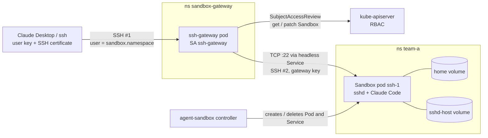
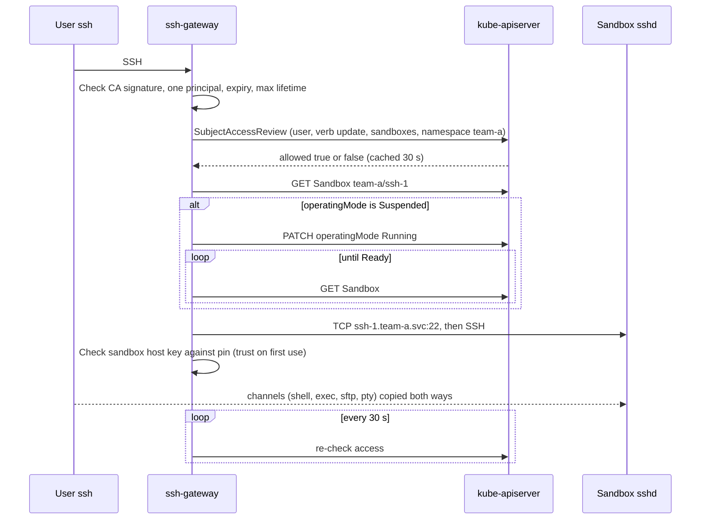
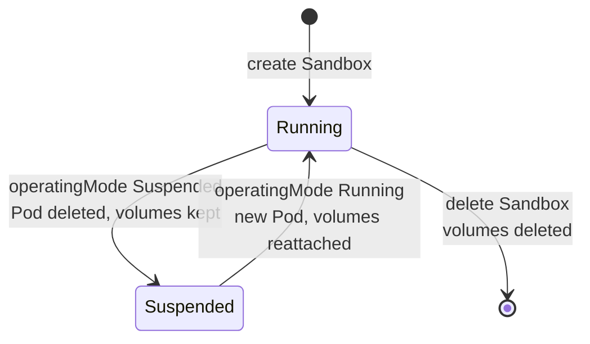

# POC report: agent-sandbox as a remote environment for agents

- Date: 2026-11-12
- Environment: local `kind` cluster on Docker Desktop (arm64), plain `runc` containers
- Project under test: [kubernetes-sigs/agent-sandbox](https://github.com/kubernetes-sigs/agent-sandbox) v1.0.10
- Client under test: Claude Code Desktop, SSH sessions
- Status: proof of concept. All code is in `/Users/minjeeson/agent-sandbox-poc`. Nothing is pushed anywhere.
- A matching report for Substrate is in `../cloud_run_report.md`. A side-by-side table is in `ssh_comparison.md`.

---

## 1. Summary

- The goal was to repeat the Substrate POC on a standard Kubernetes project. A `Sandbox` pod running `sshd` replaces a Substrate actor.
- The same idea applies. Claude Code Desktop connects over SSH to a central gateway. Each user reaches only the sandboxes they may edit.
- The path works. The sandbox runs `sshd` and Claude Code. The gateway checks access, resumes suspended sandboxes, and relays SSH.
- Access control uses Kubernetes RBAC. The gateway asks the API server whether the user may update Sandboxes in the namespace.
- The gateway is simpler than the Substrate one. It dials the sandbox Service directly. It needs no router client and no WebSocket bridge.
- Desktop connected, deployed its helper, and reattached to a running Claude session.
- Desktop's terminal and shell commands failed at first. The cause was a missing Linux capability in my manifest. It is fixed and tested with a terminal from the command line.
- Main limits found:
  - Suspend in the core controller deletes the pod. Running processes are lost. Only disk volumes survive. Memory snapshots exist only through GKE Pod Snapshots, which we did not try.
  - Outbound traffic is open by default. There is no per-sandbox hostname allowlist.
  - The pod uses the default container runtime. There is no sandbox isolation layer yet.
  - Nothing suspends idle sandboxes automatically.
- We did not confirm two things.
  - A Desktop terminal and shell command after the capability fix. Only a command-line terminal is tested.
  - That a long Claude task finishes after Desktop closes. We saw the process stay alive, not finish.

---

## 2. What we tried (in order)

- **Step 1. Read the project.**
  - The `Sandbox` custom resource is one stateful pod with a stable identity and a headless Service.
  - Isolation comes from a `RuntimeClass`, such as gVisor or Kata. The project does not provide it.
  - `operatingMode: Suspended` deletes the pod and keeps the volumes. Resume makes a new pod.
- **Step 2. Create a separate cluster.**
  - A new `kind` cluster, `agent-sandbox`, keeps the Substrate cluster untouched.
  - We installed the release manifest `sandbox-with-extensions.yaml`.
- **Step 3. Build the sandbox image.**
  - `sshd`, `git`, `gh`, and Claude Code on Debian.
  - The home directory is a volume. The image seeds it on first start.
  - The host key is on a second volume, so it survives suspend and resume.
- **Step 4. Create the sandbox.**
  - One `Sandbox`, `ssh-1`, in namespace `team-a`, with `service: true`.
  - The authorized key is the gateway key, mounted from a Secret.
- **Step 5. Build the gateway for Kubernetes.**
  - We reused the SSH relay, certificate login, and host-key pinning from the Substrate gateway.
  - We replaced the policy lookup with a Kubernetes access check.
  - We replaced the router and WebSocket path with a plain TCP dial.
  - We added resume on connect.
- **Step 6. Test the gateway.**
  - Login, denial, missing sandbox, auto-resume, concurrent sessions, certificate expiry, and revocation.
- **Step 7. Connect Claude Desktop.**
  - It connected and reattached to a running Claude session.
  - Terminal and shell commands failed, and Desktop kept reconnecting.
- **Step 8. Diagnose and fix.**
  - Added audit logging to the gateway. It showed the sandbox `sshd` dropped each connection at a terminal request.
  - We reproduced the failure from the command line, found the missing capability, and fixed it.

---

## 3. Architecture

### 3.1 Overall



- SSH #1 ends at the gateway. SSH #2 starts at the gateway.
- The SSH username names the target, in the form `<sandbox>.<namespace>`.
- The sandbox trusts one key, the gateway upstream key.
- The gateway reaches the sandbox over the normal pod network. There is no router and no tunnel.

### 3.2 Connection and authorization flow



### 3.3 Lifecycle



- A new pod starts from the image. Only files on the volumes carry over.

---

## 4. Configuration

### 4.1 Sandbox

```yaml
apiVersion: agents.x-k8s.io/v1beta1
kind: Sandbox
metadata:
  name: ssh-1
  namespace: team-a
spec:
  service: true                      # headless Service ssh-1.team-a.svc, the stable address
  podTemplate:
    spec:
      automountServiceAccountToken: false
      containers:
      - name: ssh
        image: ssh-sandbox:v1
        imagePullPolicy: Never       # kind-local image
        ports:
        - {name: ssh, containerPort: 22}
        securityContext:
          allowPrivilegeEscalation: false
          capabilities:
            drop: [ALL]
            add: [SYS_CHROOT, SETUID, SETGID, CHOWN, DAC_OVERRIDE, FOWNER, AUDIT_WRITE]
        resources:
          requests: {cpu: 250m, memory: 512Mi}
          limits: {memory: 2Gi}
        readinessProbe:
          tcpSocket: {port: ssh}
          periodSeconds: 5
        volumeMounts:
        - {name: home, mountPath: /home/dev}
        - {name: sshd-host, mountPath: /var/lib/sshd-host}
        - {name: ssh-authorized-keys, mountPath: /etc/ssh-authorized, readOnly: true}
      volumes:
      - name: ssh-authorized-keys
        secret: {secretName: ssh-authorized-keys}
  volumeClaimTemplates:
  - metadata: {name: home}
    spec: {accessModes: [ReadWriteOnce], resources: {requests: {storage: 5Gi}}}
  - metadata: {name: sshd-host}
    spec: {accessModes: [ReadWriteOnce], resources: {requests: {storage: 16Mi}}}
```

- `AUDIT_WRITE` is required for terminals. See issue 7.3.
- `SYS_CHROOT`, `SETUID`, and `SETGID` are required for `sshd` privilege separation.
- The Sandbox `volumeClaimTemplates` cannot change after creation.
- A change to `podTemplate` reaches a pod only when the pod is recreated.

### 4.2 Sandbox image

```dockerfile
FROM debian:bookworm-slim
RUN apt-get update && apt-get install -y --no-install-recommends \
      openssh-server openssh-sftp-server git ca-certificates curl gh procps less \
 && rm -rf /var/lib/apt/lists/* && mkdir -p /run/sshd \
 && rm -f /etc/ssh/ssh_host_* \
 && useradd -m -u 1000 -s /bin/bash dev && usermod -p '*' dev
USER dev
RUN curl -fsSL https://claude.ai/install.sh | bash
USER root
# The home directory is a volume, which hides the install above. The entrypoint seeds it from this copy.
RUN cp -a /home/dev /opt/dev-skel && ln -s /home/dev/.local/bin/claude /usr/local/bin/claude
COPY sshd_config /etc/ssh/sshd_config
COPY entrypoint.sh /entrypoint.sh
RUN chmod +x /entrypoint.sh
EXPOSE 22
ENTRYPOINT ["/entrypoint.sh"]
```

```bash
#!/bin/bash
# entrypoint.sh
set -eu
# The host key is on its own volume. It survives suspend and resume, and the dev user cannot read it.
if [ ! -f /var/lib/sshd-host/ssh_host_ed25519_key ]; then
  ssh-keygen -q -t ed25519 -N '' -f /var/lib/sshd-host/ssh_host_ed25519_key
fi
# First start on an empty home volume: copy the image's home (Claude Code install) into it.
if [ ! -e /home/dev/.seeded ]; then
  cp -a /opt/dev-skel/. /home/dev/
  touch /home/dev/.seeded
  chown dev:dev /home/dev /home/dev/.seeded
fi
exec /usr/sbin/sshd -D -e
```

```
# sshd_config
Port 22
HostKey /var/lib/sshd-host/ssh_host_ed25519_key
AuthorizedKeysFile /etc/ssh-authorized/authorized_keys
PasswordAuthentication no
KbdInteractiveAuthentication no
PubkeyAuthentication yes
UsePAM no
StrictModes no
PermitRootLogin no
AllowUsers dev
Subsystem sftp /usr/lib/openssh/sftp-server
```

- `sshd` runs as PID 1 in the foreground. There is no WebSocket bridge.
- The Claude Code install is copied into the home volume once. Claude can then update itself on the volume.

### 4.3 Gateway Deployment and RBAC

```yaml
# ClusterRole for the gateway: it checks access and resumes Sandboxes, nothing else
rules:
- apiGroups: [authorization.k8s.io]
  resources: [subjectaccessreviews]
  verbs: [create]
- apiGroups: [agents.x-k8s.io]
  resources: [sandboxes]
  verbs: [get, patch]
---
# Deployment excerpt
containers:
- name: ssh-gateway
  image: ssh-gateway:v3
  args:
  - -listen=:2222
  - -host-key=/etc/ssh-gateway/keys/host_key
  - -upstream-key=/etc/ssh-gateway/keys/upstream_key
  - -ca-pub=/etc/ssh-gateway/ca/ca_key.pub
  - -sandbox-hostkeys=/var/lib/ssh-gateway/sandbox_hostkeys.json
  - -authz-ttl=30s
  - -recheck=30s
  securityContext:
    allowPrivilegeEscalation: false
    readOnlyRootFilesystem: true
    capabilities: {drop: [ALL]}
```

### 4.4 Who may connect

```yaml
# A user may connect to every Sandbox in team-a if RBAC lets them update Sandboxes there
apiVersion: rbac.authorization.k8s.io/v1
kind: Role
metadata: {name: sandbox-editor, namespace: team-a}
rules:
- apiGroups: [agents.x-k8s.io]
  resources: [sandboxes]
  verbs: [get, list, watch, update, patch]
---
apiVersion: rbac.authorization.k8s.io/v1
kind: RoleBinding
metadata: {name: sandbox-editors, namespace: team-a}
roleRef: {apiGroup: rbac.authorization.k8s.io, kind: Role, name: sandbox-editor}
subjects:
- {apiGroup: rbac.authorization.k8s.io, kind: User, name: alice}
```

- The certificate principal is the Kubernetes user name.
- To add a user, add a subject to the RoleBinding.
- To remove a user, delete the subject. New logins stop within the cache time. Live sessions end at the next re-check.

### 4.5 Client configuration

```
# ~/.ssh/config (Claude Desktop uses this host)
Host sandbox-1
  HostName 127.0.0.1
  Port 2226                                  # port-forward to the gateway
  User ssh-1.team-a                          # <sandbox>.<namespace>
  IdentityFile /Users/minjeeson/agent-sandbox-poc/keys/id_alice
  CertificateFile /Users/minjeeson/agent-sandbox-poc/keys/id_alice-cert.pub
  IdentitiesOnly yes
  StrictHostKeyChecking accept-new
```

```bash
# kind has no load balancer. Keep this running. It restarts the port-forward when the tunnel breaks.
./forward.sh

# Issue an 8-hour certificate (prototype: run by hand with the CA key)
./gw-tool issue -ca keys/ca_key -pub keys/id_alice.pub -principal alice -ttl 8h | tail -1 > keys/id_alice-cert.pub
```

---

## 5. Ad-hoc code we wrote

### 5.1 Access check with the Kubernetes API

```go
// canUpdateSandboxes asks the API server whether user may update Sandboxes in namespace.
// Whoever Kubernetes RBAC lets edit Sandboxes may connect.
func (k *kubeClient) canUpdateSandboxes(ctx context.Context, user, namespace string) (bool, error) {
	body, _ := json.Marshal(map[string]any{
		"apiVersion": "authorization.k8s.io/v1",
		"kind":       "SubjectAccessReview",
		"spec": map[string]any{
			"user": user,
			"resourceAttributes": map[string]any{
				"namespace": namespace, "verb": "update", "group": sandboxGroup, "resource": "sandboxes",
			},
		},
	})
	b, code, err := k.do(ctx, http.MethodPost, "/apis/authorization.k8s.io/v1/subjectaccessreviews", "application/json", body)
	...
}
```

- The client uses the standard library and the pod's ServiceAccount token. It has no `client-go` dependency.

### 5.2 Cache and fail closed

```go
// A revocation takes effect within ttl. An error reading the decision denies.
// An expired entry is never used to allow.
func (a *authorizer) Allowed(ctx context.Context, principal, namespace string) (bool, error) {
	key := principal + "\x00" + namespace
	a.mu.Lock()
	defer a.mu.Unlock() // one lookup at a time keeps a burst of connections to one API call
	if d, ok := a.cache[key]; ok && a.now().Sub(d.at) < a.ttl {
		return d.allowed, nil
	}
	ok, err := a.src.canUpdateSandboxes(ctx, principal, namespace)
	if err != nil {
		delete(a.cache, key)
		return false, err
	}
	a.cache[key] = decision{allowed: ok, at: a.now()}
	return ok, nil
}
```

### 5.3 Resume on connect

```go
// ensureRunning returns once the sandbox exists and is Ready. It resumes a suspended sandbox first.
func (k *kubeClient) ensureRunning(ctx context.Context, namespace, name string) error {
	st, err := k.getSandbox(ctx, namespace, name)
	if errors.Is(err, errSandboxNotFound) {
		return fmt.Errorf("sandbox %s/%s does not exist", namespace, name)
	}
	...
	if st.suspended {
		log.Printf("audit resume sandbox=%s/%s", namespace, name)
		if err := k.resume(ctx, namespace, name); err != nil { // PATCH {"spec":{"operatingMode":"Running"}}
			return err
		}
		st.ready = false
	}
	for !st.ready { /* poll the Ready condition every second until the context ends */ }
	return nil
}
```

### 5.4 Dial the sandbox

```go
func dialUpstream(namespace, sandbox string, signer ssh.Signer) (*ssh.Client, func(), error) {
	ctx, cancel := context.WithTimeout(context.Background(), *readyWait)
	defer cancel()
	if err := kube.ensureRunning(ctx, namespace, sandbox); err != nil {
		return nil, nil, err
	}
	addr := net.JoinHostPort(fmt.Sprintf("%s.%s.svc", sandbox, namespace), *sshPort)
	// retry TCP until sshd answers, then SSH as user "dev" with the gateway key
	...
	HostKeyCallback: func(_ string, _ net.Addr, key ssh.PublicKey) error {
		first, err := pins.verify(namespace+"/"+sandbox, key)   // trust on first use
		...
	},
}
```

### 5.5 Diagnostic logging that found the terminal bug

```go
// Added to proxyChannel and handleConn. It logs which side closes first and what Desktop asks for.
log.Printf("audit chan-open type=%s", newCh.ChannelType())
log.Printf("audit chan-req type=%s payload=%q", r.Type, cmd)          // exec and subsystem only, first 140 bytes
go func() {
	err := up.Wait()
	log.Printf("audit upstream-closed ... after=%s err=%v", ..., err)  // the sandbox side closed
}()
```

- The log showed `upstream-closed err=EOF` in the same second as every `pty-req`.
- This logging includes command text. It is temporary and must be removed before real use.

### 5.6 Port-forward keeper

```bash
#!/bin/bash
# forward.sh: kubectl port-forward exits when its tunnel breaks, for example after laptop sleep
while true; do
  kubectl --context "${CTX:-kind-agent-sandbox}" -n sandbox-gateway port-forward svc/ssh-gateway 2226:22
  echo "$(date) port-forward exited, restarting" >&2
  sleep 1
done
```

### 5.7 Tests written

- Authorizer tests cover caching within the time limit, expiry, per-namespace decisions, and fail closed when the API is down.
- Access-check tests use a fake API server for a normal answer and for an error.
- Resume tests cover resuming a suspended sandbox and a missing sandbox.
- Certificate and host-key tests came from the Substrate gateway and still pass.

---

## 6. Test results

- **Passed.** `alice` (editor) logs in through the gateway. `claude --version` runs as `dev`.
- **Passed.** SFTP upload and download, and six concurrent sessions.
- **Passed.** `bob`, with no RoleBinding, gets `Permission denied`. The log says `bob may not update sandboxes in namespace team-a`.
- **Passed.** A missing sandbox gives `sandbox team-a/nope does not exist`.
- **Passed.** Connecting to a suspended sandbox resumes it. The files and the host key are the same afterward.
- **Passed.** A 45-second certificate closes the session at 46 seconds. New logins fail.
- **Passed.** Deleting the RoleBinding ends a live session after 31 seconds and blocks new logins.
- **Passed.** A terminal through the gateway returns `/dev/pts/0`, after the capability fix.
- **Observed.** Desktop connected, deployed its helper, and reattached to a running Claude session. That session process stayed alive while Desktop was closed and the laptop slept.
- **Observed.** A process started in the sandbox did not survive suspend and resume. Files did.
- **Not confirmed.** A Desktop terminal and shell command after the fix.
- **Not confirmed.** A long Claude task that finishes while Desktop is closed.

---

## 7. Issues we faced

### 7.1 Setup

- **Docker Desktop was not running.** The earlier cluster was down. We started Docker Desktop and waited for the API.
- **`kind create cluster` changed the default kubectl context.**
  - Commands without `--context` would have hit the new cluster.
  - We switched the default back and used `--context kind-agent-sandbox` for this POC.

### 7.2 Gateway and tests

- **A process check gave a false result.**
  - `pgrep -f "sleep 3600"` matched its own shell, so a process seemed to survive suspend.
  - `pgrep -x sleep` showed zero processes, and the pod start time showed a new pod.
- **A readiness wait returned too early after resume.** The `kubectl wait` returned before the pod was recreated. We checked pod start time and process uptime instead.
- **The denial log used Substrate wording.** It said `is not an editor or owner of namespace`. We changed it to `may not update sandboxes in namespace`.
- **Missing import.** The new `main.go` lacked `regexp`. The build failed and we added it.

### 7.3 Terminal requests killed the connection

- **Symptom.**
  - Desktop connected, then the SSH transport dropped within seconds.
  - Desktop logged `channel exited 255` and `Connection flapping`. Its error was `SSH shell exited before becoming ready`.
- **Evidence.**
  - The gateway log showed `upstream-closed err=EOF` in the same second as each `pty-req`.
  - A direct `ssh -tt` to the sandbox `sshd` failed with `closed by remote host`.
  - The `sshd` log showed `linux_audit_write_entry failed: Operation not permitted`.
- **Cause.**
  - The manifest dropped all capabilities and added six back. `AUDIT_WRITE` was not one of them.
  - Debian's OpenSSH records a terminal login with the kernel audit system. Without the capability the write fails and `sshd` ends the session.
  - Plain commands and SFTP never request a terminal, so earlier tests passed.
- **Fix.** Add `AUDIT_WRITE` and recreate the pod.
- **Cost.** Recreating the pod ended every running process in the sandbox, including an attached Claude session.

### 7.4 Laptop sleep and the tunnel

- **A first reconnect failed after the laptop slept.**
  - The VM uptime inside the pod was about 37 minutes against a pod age of nearly 3 hours. Docker's VM was paused.
  - The port-forward may have held a stale connection. We did not prove this.
- **We added `forward.sh`.** It restarts the port-forward when it exits. It does not help if the process stays alive with a dead tunnel.

---

## 8. Limitations

### 8.1 Lifecycle

- **L1. Suspend loses running processes.**
  - The core controller has no memory snapshot. Only the volumes persist.
  - GKE Pod Snapshots add memory and filesystem snapshots, stored in a GCS bucket. They need GKE with gVisor and the Python SDK. We did not try them, and they do not work on `kind`.
  - Any pod restart ends processes. That includes suspend, an image change, a node restart, and an out-of-memory kill.
  - A long agent task must tolerate a restart. Claude's transcripts are on the volume, so `--resume` can continue the conversation. A tool call in flight is lost.
- **L2. No automatic idle suspend.**
  - A sandbox can expire at a fixed time with `shutdownTime`. Nothing suspends it when idle.
  - A reaper that suspends on idle SSH would kill a task that runs with no SSH session attached.
- **L3. Changing the pod needs a restart.** A change to the manifest applies only to a new pod. Capabilities, image, and limits all work this way.
- **L4. The cluster is local.** Work stops when the laptop sleeps. The VM pause also breaks the port-forward.

### 8.2 Security

- **L5. No sandbox runtime.**
  - The pod uses the default container runtime. A process escape reaches the node kernel.
  - gVisor or Kata needs a `RuntimeClass`. kind does not include one.
- **L6. Egress is open by default.**
  - Any pod can reach any address. Kubernetes `NetworkPolicy` filters by IP, not by hostname. Hostname filtering needs a plugin such as Cilium. The project has an example.
  - A prompt-injected agent can send data anywhere.
- **L7. Any pod can reach the sandbox on port 22.**
  - Only the gateway holds the upstream key. A `NetworkPolicy` that admits only the gateway would add a layer. We did not add one.
  - `kind`'s default network plugin may not enforce `NetworkPolicy`. We did not check.
- **L8. All sandboxes trust one upstream key.** The private key is in a Secret in the gateway namespace. If an attacker takes the gateway, they reach all sandboxes.
- **L9. Certificates are issued by hand.** A command-line tool signs them with the CA key. There is no Entra login.
- **L10. Secrets in the sandbox are visible to the agent.**
  - An env var or a mounted Secret is readable by anything in the pod. There is no gateway-side credential injection.
  - Volumes are plain disk. We did not check encryption of the storage class.
- **L11. The gateway can resume any sandbox.** Its ClusterRole allows `get` and `patch` on every Sandbox. The gateway checks the user first. A bug in that check would let a user resume a sandbox they cannot edit.

### 8.3 Product fit

- **L12. Access is per namespace, not per sandbox.** Everyone who can update Sandboxes in a namespace reaches all of them.
- **L13. Users must be Kubernetes subjects.**
  - The RoleBinding names the certificate principal as a Kubernetes user. Real users need an identity provider that the cluster trusts, or a mapping step.
- **L14. One pod per sandbox.**
  - Each sandbox holds a pod and its requested resources while it runs. There is no multiplexing of many idle sandboxes onto few workers.
- **L15. Logs show little.** `kubectl logs` for the sandbox shows `sshd` lines only. What Claude did is in `~/.claude/projects` on the volume.
- **L16. The code is not in a repository.** It is in a local folder, and the gateway code is a fork of the Substrate gateway.

---

## 9. Open items

- Test a Desktop terminal and shell command after the capability fix.
- Test that a long Claude task finishes while Desktop is closed, and decide how to handle a pod restart.
- Add a `NetworkPolicy` that admits only the gateway on port 22, and check that the cluster enforces it.
- Add egress filtering with hostnames, for example with Cilium, and test it with Claude's hosts.
- Install gVisor on a node and run the sandbox with a `RuntimeClass`. Check that `sshd` still works.
- Decide how users prove who they are, and how that becomes a Kubernetes user. Replace the manual certificate tool.
- Remove the command text from the gateway audit log.
- Decide on idle behavior. Without memory snapshots, an idle reaper needs a safe rule.
- Try GKE Pod Snapshots for memory-preserving suspend, on GKE with a gVisor node pool. Check the bucket access model, because the pod's identity gets write access to the bucket.

---

## 10. Useful commands

```bash
C=kind-agent-sandbox

kubectl --context $C -n team-a get sandbox,pod,svc,pvc
kubectl --context $C -n team-a logs ssh-1                              # sshd only
kubectl --context $C -n team-a patch sandbox ssh-1 --type=merge -p '{"spec":{"operatingMode":"Suspended"}}'
kubectl --context $C -n team-a patch sandbox ssh-1 --type=merge -p '{"spec":{"operatingMode":"Running"}}'
kubectl --context $C -n sandbox-gateway logs deploy/ssh-gateway -f     # audit log
kubectl --context $C auth can-i update sandboxes -n team-a --as alice  # same check the gateway runs

# What did Claude do in the sandbox?
ssh sandbox-1 'tail -n 20 $(ls -t ~/.claude/projects/*/*.jsonl | head -1)'
# Desktop's helper log
ssh sandbox-1 'tail -n 20 ~/.claude/remote/run/*/remote-server.log'
# Desktop's own log on the Mac
tail -n 40 ~/Library/Logs/Claude/ssh.log
```
