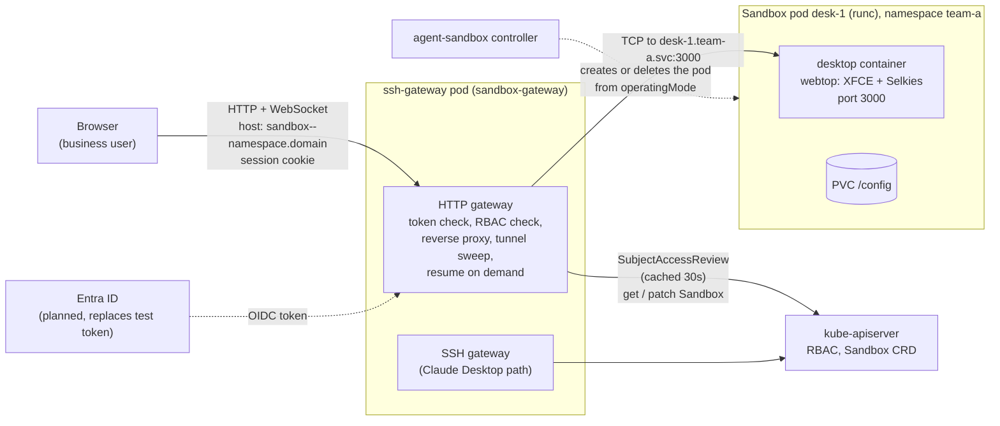

# POC report: a virtual desktop for business users on agent-sandbox

- Date: 2026-11-19
- Environment: local `kind` cluster on Docker Desktop (arm64), agent-sandbox v1.0.10, default runtime (runc)
- Desktop under test: LinuxServer `webtop` (XFCE, streamed by Selkies over WebSocket), the stock image
- Builds on: [agent-sandbox.md](agent-sandbox.md) (SSH gateway, RBAC check). Same test as the Substrate desktop POC: [../desktop_poc_report.md](../desktop_poc_report.md)
- Compared with Substrate in [../desktop_comparison.md](../desktop_comparison.md)
- Status: proof of concept. Nothing is upstream.

---

## 1. Summary

- The requirement: business users who want a graphical desktop, reachable only by the person who owns the sandbox.
- The stock webtop image runs in a `Sandbox` with no changes. It needed no capabilities, no shim and no rebuilt image. The pod was ready in about 15s.
- An HTTP gateway sits in front of the desktop. It is the same code as the Substrate one, with two differences.
  - The access check is a Kubernetes RBAC `SubjectAccessReview`: may this user update Sandboxes in the namespace?
  - It dials the Sandbox's headless Service directly, and resumes a suspended Sandbox when a request arrives.
- Owner gets 200. A user with no RBAC binding and another namespace get 403. WebSocket works in a browser.
- A revoked user is cut off in about a minute at worst. We measured 18s once.
- Suspend and resume lose open apps. Files on the volume survive. Suspend took 64s and resume about 11s.
- Not done: Entra sign-in, hostname egress control (kind does not enforce `NetworkPolicy`), clipboard, audio, file transfer, and the snapshot case on GKE.

---

## 2. Architecture

There is no router. The gateway runs in the cluster and reaches the Sandbox through its Service. A `NetworkPolicy` that admits only the gateway could limit who reaches the pod, but kind's network does not enforce it, so the POC relies on nothing else listing the Service.

| Component | What it does |
|---|---|
| Browser | Opens one URL per Sandbox, `<sandbox>--<namespace>.<domain>`, and keeps a session cookie set at login. |
| HTTP gateway (`httpgw.go`) | Verifies the token, runs the access check, then reverse-proxies HTTP and WebSocket. It removes the token and cookie before forwarding and writes an audit line per tunnel. Shared with the Substrate POC. |
| Access check (`kube.go`) | A `SubjectAccessReview` as the token's subject: may it `update` `sandboxes` in the namespace? Whoever RBAC lets edit Sandboxes there gets in. Decisions are cached 30s, and an error denies. |
| Tunnel tracker | Records every open tunnel with its owner and token expiry. A sweep every 30s closes tunnels whose token expired or whose owner lost access. |
| Resume on demand (`svcdial.go`) | If the dial fails, it reads the Sandbox, patches `operatingMode: Running` if suspended, waits for Ready and dials again. |
| Token (`token.go`) | A signed JWT (Ed25519) with the subject and expiry. It stands in for the Entra token. The subject must equal the RBAC user name. |
| agent-sandbox controller | Turns a Sandbox into a pod, a headless Service and PVCs. `operatingMode: Suspended` deletes the pod and keeps the PVCs. |
| Sandbox pod | One pod. `desktop` runs webtop on port 3000 with no login of its own. `/config` is a PVC, and `/dev/shm` is a memory `emptyDir`. |
| Entra ID (planned) | Would sign users in and provide the subject that maps to an RBAC user. |

---

## 3. Results

| Check | Result |
|---|---|
| Stock webtop runs with no fixes | Works. Panel, window manager and Selkies started. Pod ready in about 15s |
| Desktop loads in a browser through the gateway, WebSocket included | Works |
| No token | 401 |
| Owner (`alice`, RBAC editor on `team-a`) | 200 |
| `bob`, no RBAC binding | 403 |
| Owner on another namespace | 403 |
| Suspend | Pod gone after 64s |
| Resume | About 11s from the first request to Ready (01:42:43 to 01:42:54), started by the gateway |
| File on the `/config` volume across suspend | Survived |
| Open editor and terminal across suspend | Lost (the process check went from 1 to 0) |
| Revoke `alice` (delete the RoleBinding) | Tunnel closed after 18s, new requests got 403 one second later. Worst case about 60s |
| Reach any HTTPS host from the sandbox | Yes. `curl https://www.google.com` returned 200 |

---

## 4. Findings

- **runc needed nothing extra.** On Substrate the same image needed seven capabilities and a `bwrap` shim, because gVisor lacks features the desktop expects. Under runc the container has the default Linux capabilities and the `bwrap` sandbox for the image loader works. The cost is isolation. A runc pod shares the node kernel with every other pod, and the container starts as root (s6-overlay), with the apps running as uid 1000.
- **Auto-resume was easy here.** The gateway already patched `operatingMode` for the SSH path. Reusing it for HTTP took a small dialer. A browser tab open during a suspend reconnects by itself. The first requests during a resume failed with DNS `no such host` or `context canceled`, then the page recovered.
- **Suspend is slow.** The pod took 64s to go away. We did not investigate. The webtop shutdown and the pod's termination grace period are the likely causes.
- **No memory snapshot.** The core controller keeps volumes only. GKE Pod Snapshots would keep memory and filesystem, but need GKE with gVisor and have a Python SDK only. We could not test it on kind.
- **Egress is open.** Kind's default CNI ignores `NetworkPolicy`. Even with a CNI that enforces it, a `NetworkPolicy` matches IP ranges, not host names. Allowing only some HTTPS hosts needs an egress proxy or a CNI with DNS-based rules (for example Cilium). Not tried.
- **The Service is the only boundary.** The desktop has no login. Anyone who can reach `desk-1.team-a.svc:3000` in the cluster gets in. A `NetworkPolicy` from the gateway namespace would close this, once the CNI enforces it.

---

## 5. Limitations

- **No Entra sign-in.** The token is signed by a key we made. A real deployment needs the OIDC flow, and the subject must match the RBAC user name (`oidc:` prefixes and group claims are a decision).
- **Ownership is "may update Sandboxes in the namespace".** That is namespace RBAC, so it is as granular as Roles and RoleBindings. It cannot say "only the user who created this one Sandbox" without a per-Sandbox `resourceNames` rule.
- **Open windows and unsaved work are lost on suspend** without a snapshot feature.
- **The session cookie is not `Secure`.** The POC uses plain HTTP on localhost.
- **One tunnel per HTTP request.** Many connections may cost latency.
- **Runtime is runc.** A gVisor or Kata `RuntimeClass` was not tried, so the isolation of the desktop is weaker than on Substrate.
- **Idle behavior was not tested.** There is no router, so the 5-minute cut seen on Substrate should not apply, but we did not run a long idle session.
- **Clipboard, audio, file transfer, latency and several users were not tested.**
- **The 3.34GB image is loaded into the kind node.** It cost local disk on a laptop that was nearly full.
- **Local `kind` only.**

---

## 6. Next steps

1. Install a CNI that enforces `NetworkPolicy` and test a gateway-only ingress rule and a hostname egress rule.
2. Try a gVisor `RuntimeClass` and see what the desktop needs there.
3. Entra OIDC sign-in, then the subject mapping.
4. Find out why suspend takes 64s.
5. If snapshots matter, test GKE Pod Snapshots.

---

## 7. Files

- `gateway/httpgw.go`, `gateway/token.go`, `gateway/httpgw_test.go`: the HTTP gateway, the test token and tests, copied from the Substrate POC.
- `gateway/svcdial.go`: the Service dialer that resumes a suspended Sandbox.
- `gateway/main.go`: the new flags (`-http-listen`, `-http-domain`, `-http-sandbox-port`, `-token-pub`) and `issue-token`.
- `k8s/gateway.yaml`: the HTTP port, Service port and token ConfigMap mount.
- `desktop/desktop-sandbox.yaml`: the desktop Sandbox.

To try it:

    kind load docker-image lscr.io/linuxserver/webtop:ubuntu-xfce --name agent-sandbox
    kubectl --context kind-agent-sandbox apply -f desktop/desktop-sandbox.yaml
    go run ./gateway issue-token -key token_key -sub alice -ttl 8h
    kubectl -n sandbox-gateway create configmap http-gateway-token-pub --from-file=token_pub=token_key.pub
    kubectl -n sandbox-gateway port-forward svc/ssh-gateway 8081:80
    open "http://desk-1--team-a.localhost:8081/_gw/login?token=<token>"
