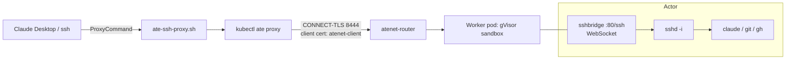
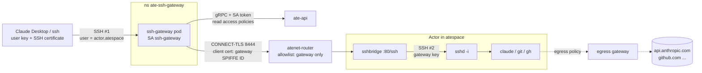
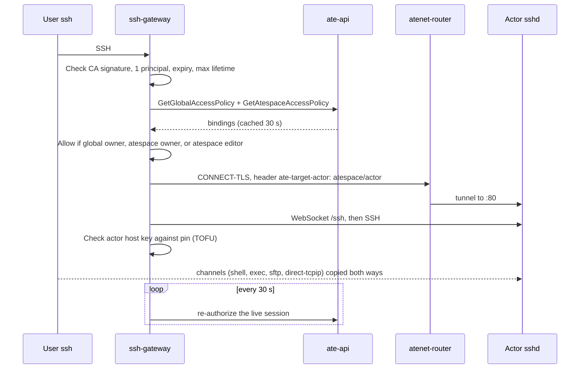
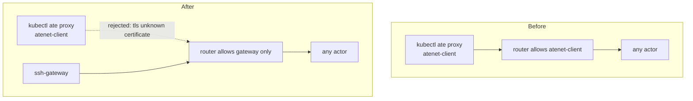

# POC report: Substrate as a remote environment for agents

- Date: 2026-11-04
- Environment: local `kind` cluster on Docker Desktop (arm64), gVisor sandbox
- Client under test: Claude Code Desktop, SSH sessions
- Status: proof of concept. Nothing is in the Substrate repo. All code is in a scratch folder.

---

## 1. Summary

- The goal was to use a Substrate actor as the remote machine for Claude Code Desktop SSH sessions.
- A second goal was to let many users share one Substrate. Each user reaches only their own actors.
- The transport works. A shell, SFTP, and Claude Code all run in an actor.
- A central SSH gateway enforces access. It reads Substrate access policies.
- The gateway runs in the cluster. The router accepts only the gateway.
- Four problems block production use.
  - Outbound TLS from an actor stops after a long run. Suspend and resume fixes it. The cause is unknown.
  - This build has no automatic idle suspend.
  - A snapshot holds the full memory and disk of an actor, so it can hold secrets.
  - A person issues certificates by hand. There is no Entra integration.
- We did not confirm two things.
  - A full Claude Desktop prompt through the in-cluster gateway, after the last change.
  - Several SSH logins to one actor at the same time.

---

## 2. What we tried

- **Step 1. Run Substrate locally.**
  - We installed Substrate on `kind`. The counter demo ran.
  - The sandbox needed a Docker Desktop kernel update. See section 7.1.
- **Step 2. SSH spike for one user.**
  - We built an actor image with `sshd`, Claude Code, `git`, and `gh`.
  - We wrote a small bridge program. It connects a WebSocket to an `sshd` session.
  - We reached the actor with `kubectl ate proxy` and a `ProxyCommand`.
  - Claude Desktop connected and ran Claude in the actor.
- **Step 3. Gateway design.**
  - We chose one atespace per user or team as the ownership model.
  - Stage 1 keeps `sshd` in the actor. Stage 2 removes it. Stage 2 is not built.
- **Step 4. Gateway prototype on a laptop.**
  - The gateway ends the user SSH connection.
  - It opens a second SSH connection to the actor.
  - It copies every SSH channel between the two connections.
- **Step 5. Authorization.**
  - The gateway reads Substrate access policies.
  - It allows a global owner, an atespace owner, or an atespace editor.
- **Step 6. Certificate login.**
  - A CA signs short-lived SSH certificates for users.
- **Step 7. Actor hardening.**
  - The actor accepts only the gateway key.
  - Each actor makes its own host key on first use.
  - The gateway pins each actor host key.
- **Step 8. Move the gateway into the cluster.**
  - The gateway runs as a Deployment. It uses its own identity for the router and `ate-api`.
  - The router allowlist now lists only the gateway.
- **Step 9. Egress policies.**
  - Each actor has an allowlist for Anthropic and GitHub hosts.

---

## 3. Architecture

### 3.1 Spike: one user, direct path



- The `ProxyCommand` starts `kubectl ate proxy` on a free port.
- `sshproxy` copies bytes between the SSH client and the WebSocket.
- `sshbridge` runs `sshd -i` with the WebSocket as stdin and stdout.
- The spike uses one shared key pair and one shared host key. It supports one user only.

### 3.2 Final: in-cluster gateway



- SSH #1 ends at the gateway. SSH #2 starts at the gateway.
- The SSH username names the target, in the form `<actor>.<atespace>`.
- The actor trusts one key, the gateway upstream key.
- The router checks only the gateway SPIFFE ID. It cannot see the user.
- The gateway is the only place that controls access.

### 3.3 Connection and authorization flow



### 3.4 Router access: before and after



---

## 4. Configuration

### 4.1 Worker pool and template

```yaml
# pool.yaml (excerpt)
apiVersion: ate.dev/v1
kind: WorkerPool
metadata:
  name: ssh-workerpool
  namespace: ate-spike-ssh
  labels: { workload: sshspike }
spec:
  replicas: 1            # raised to 2 during the test
  workerImage: localhost:5001/ateworker-gvisor@sha256:e32a43657e68...
  sandboxClasses: [{ name: gvisor }]
  template:
    resources:
      limits:   { cpu: "1",   memory: 1Gi }
      requests: { cpu: 250m,  memory: 1Gi }
```

```yaml
# template-v6.yaml
metadata: { atespace: ate-spike-ssh, name: ssh-template-v6 }
workerSelector: { matchLabels: { workload: sshspike } }
containers:
- name: ssh
  image: localhost:5001/sshspike@sha256:59110b99c654...
  securityContext:
    capabilities:
      add: [SYS_CHROOT, SETUID, SETGID, CHOWN, DAC_OVERRIDE, FOWNER]  # sshd needs these
resources:
  limits: { cpuMillicores: 500, memoryBytes: 805306368 }   # 768 MiB; must fit worker capacity
snapshotConfig: { preferredFidelity: SNAPSHOT_FIDELITY_MEMORY }
```

- The template must add these capabilities. gVisor does not grant `CAP_SYS_CHROOT` or `CAP_SETUID` by default.
- A template cannot change after you create it. To change it, create a new template version.

### 4.2 Actor image

```dockerfile
FROM golang:1.24 AS build
WORKDIR /src
COPY go.mod main.go ./
RUN go mod tidy && CGO_ENABLED=0 go build -o /sshbridge .

FROM debian:bookworm-slim
RUN apt-get update && apt-get install -y --no-install-recommends \
      openssh-server openssh-sftp-server git ca-certificates curl gh procps less \
 && rm -rf /var/lib/apt/lists/* && mkdir -p /run/sshd \
 && rm -f /etc/ssh/ssh_host_* \                      # no shared host keys in the image
 && useradd -m -s /bin/bash dev && usermod -p '*' dev \
 && mkdir -p /home/dev/.ssh && chown dev:dev /home/dev/.ssh && chmod 700 /home/dev/.ssh
USER dev
RUN curl -fsSL https://claude.ai/install.sh | bash
ENV PATH=/home/dev/.local/bin:$PATH
USER root
RUN ln -s /home/dev/.local/bin/claude /usr/local/bin/claude
COPY authorized_keys /home/dev/.ssh/authorized_keys   # gateway upstream public key only
RUN chown dev:dev /home/dev/.ssh/authorized_keys && chmod 600 /home/dev/.ssh/authorized_keys
COPY sshd_config /etc/ssh/sshd_config
COPY --from=build /sshbridge /sshbridge
ENTRYPOINT ["/sshbridge"]
```

```
# sshd_config
Port 22
HostKey /etc/ssh/ssh_host_ed25519_key
PasswordAuthentication no
KbdInteractiveAuthentication no
PubkeyAuthentication yes
UsePAM no
StrictModes no
PermitRootLogin no
Subsystem sftp /usr/lib/openssh/sftp-server
```

### 4.3 Egress policy (per actor)

```yaml
# egress-ssh7.yaml (before the GitHub additions)
rules:
- tlsPassthrough:
    hostnames:
    - api.anthropic.com
    - claude.ai
    - platform.claude.com
    - downloads.claude.ai
    - statsig.anthropic.com
    - github.com
    - api.github.com
    - codeload.github.com
    - objects.githubusercontent.com
    - registry.npmjs.org
    ports: { numbers: [443] }
```

- We later added these GitHub hosts: `raw.githubusercontent.com`, `uploads.github.com`, `gist.github.com`,
  `gist.githubusercontent.com`, `release-assets.githubusercontent.com`,
  `github-releases.githubusercontent.com`, `github-cloud.githubusercontent.com`,
  `camo.githubusercontent.com`, `avatars.githubusercontent.com`, `ghcr.io`,
  `pkg-containers.githubusercontent.com`.
- Create a policy with `kubectl ate create egress-policy <actor> -a <atespace> -f file.yaml`.
- An update needs `metadata.uid` and `metadata.version`. Get them from `get egress-policy -o json`.
- A policy change applies to a running actor in about 5 seconds.
- A blocked name returns `NXDOMAIN` in the actor. Nothing logs the name.

### 4.4 Access policies

```yaml
# Global policy: the gateway can read policies, nothing more
bindings:
- role: viewer
  members:
  - user:system:serviceaccount:ate-ssh-gateway:ssh-gateway
```

```yaml
# Atespace policy (example): one user as editor
bindings:
- role: editor
  members:
  - user:alice
```

- Create a policy with `kubectl ate create access-policy (--global | -a <atespace>) -f file.yaml`.
- A principal is the JWT `sub` claim, with the prefix `user:`.
- The actions `can_resume` and `can_suspend` need the `editor` role.

### 4.5 Gateway Deployment (key parts)

```yaml
apiVersion: v1
kind: Namespace
metadata:
  name: ate-ssh-gateway
  labels: { ate.dev/api-access: "true" }     # lets the pod reach ate-api
---
# Deployment excerpt
containers:
- name: ssh-gateway
  image: localhost:5001/sshgateway@sha256:58c12f186b83...
  args:
  - -listen=:2222
  - -host-key=/etc/ssh-gateway/keys/host_key
  - -upstream-key=/etc/ssh-gateway/keys/upstream_key
  - -ca-pub=/etc/ssh-gateway/ca/ca_key.pub
  - -actor-hostkeys=/var/lib/ssh-gateway/upstream_hostkeys.json
  - -router-addr=atenet-router.ate-system.svc:8444
  - -api-addr=api.ate-system.svc:443
  - -policy-ttl=30s
  - -recheck=30s
volumes:
- name: podidentity                      # client certificate for the router
  projected:
    sources:
    - podCertificate:
        signerName: podidentity.podcert.ate.dev/identity
        keyType: ECDSAP256
        credentialBundlePath: credential-bundle.pem
- name: servicedns-ca                    # verifies router and ate-api certificates
  projected:
    sources:
    - clusterTrustBundle:
        signerName: servicedns.podcert.ate.dev/identity
        labelSelector: { matchLabels: { podcert.ate.dev/canarying: live } }
        path: trust-bundle.pem
- name: api-token                        # bearer token for ate-api
  projected:
    sources:
    - serviceAccountToken:
        audience: api.ate-system.svc
        expirationSeconds: 3600
        path: token
```

### 4.6 Router allowlist change

```bash
# Add the gateway, test, then remove atenet-client (arg index 15 on this install)
kubectl -n ate-system patch deploy atenet-router --type=json -p \
 '[{"op":"replace","path":"/spec/template/spec/containers/0/args/15",
    "value":"--ingress-allowed-spiffe-ids=spiffe://cluster.local/ns/ate-ssh-gateway/sa/ssh-gateway"}]'
```

### 4.7 Client configuration

```
# ~/.ssh/config: gateway with certificate (Claude Desktop uses this host)
Host ssh-7-cert
  HostName 127.0.0.1
  Port 2225                                  # port-forward to the in-cluster gateway
  User ssh-7.ate-spike-ssh                   # <actor>.<atespace>
  IdentityFile ~/.ssh/substrate/id_alice
  CertificateFile ~/.ssh/substrate/id_alice-cert.pub
  IdentitiesOnly yes
  StrictHostKeyChecking accept-new
```

```bash
# kind has no load balancer, so keep this running
kubectl -n ate-ssh-gateway port-forward svc/ssh-gateway 2225:22

# Issue a 4-hour certificate (prototype: run by hand with the CA key)
./ssh-gateway issue -ca ca_key -pub id_alice.pub -principal alice -ttl 4h \
  | tail -1 > ~/.ssh/substrate/id_alice-cert.pub
```

---

## 5. Ad-hoc code we wrote

### 5.1 `sshbridge` (in the actor): WebSocket to `sshd -i`

```go
// Make this actor's host key on first use. It must not be in the image
// or in the golden snapshot: both are shared by every actor.
func ensureHostKey() error {
	hostKeyMu.Lock()
	defer hostKeyMu.Unlock()
	if _, err := os.Stat(hostKeyPath); err == nil {
		return nil
	}
	if out, err := exec.Command("ssh-keygen", "-q", "-t", "ed25519", "-N", "", "-f", hostKeyPath).CombinedOutput(); err != nil {
		return fmt.Errorf("ssh-keygen: %v: %s", err, strings.TrimSpace(string(out)))
	}
	return nil
}

mux.HandleFunc("/ssh", func(w http.ResponseWriter, r *http.Request) {
	c, err := websocket.Accept(w, r, nil)
	if err != nil { return }
	if err := ensureHostKey(); err != nil {
		c.Close(websocket.StatusInternalError, "host key unavailable")
		return
	}
	nc := websocket.NetConn(ctx, c, websocket.MessageBinary)
	cmd := exec.CommandContext(ctx, "/usr/sbin/sshd", "-i", "-e")
	cmd.Stdin, cmd.Stdout, cmd.Stderr = nc, nc, os.Stderr   // socket is sshd's stdio
	log.Printf("ssh session start")
	err = cmd.Run()
	log.Printf("ssh session end: %v", err)
})
```

### 5.2 `sshproxy` (client side, spike): stdin and stdout to WebSocket

```go
c, _, err := websocket.Dial(ctx, os.Args[1], nil)          // ws://127.0.0.1:<port>/ssh
nc := websocket.NetConn(ctx, c, websocket.MessageBinary)
go func() { io.Copy(nc, os.Stdin);  done <- struct{}{} }()
go func() { io.Copy(os.Stdout, nc); done <- struct{}{} }()
<-done
```

### 5.3 `ate-ssh-proxy.sh` (spike `ProxyCommand`)

```bash
#!/bin/bash
# usage: ate-ssh-proxy.sh <atespace> <actor>
ATESPACE="$1"; ACTOR="$2"
LOG=$(mktemp -t ate-ssh-proxy)
kubectl-ate --context "${ATE_KUBE_CONTEXT:-kind-kind}" proxy actor "$ACTOR" -a "$ATESPACE" :80 >"$LOG" 2>&1 &
PID=$!; trap 'kill $PID 2>/dev/null; rm -f "$LOG"' EXIT
for _ in $(seq 1 100); do                                    # wait for "Proxying 127.0.0.1:<port>"
  PORT=$(sed -n 's/^Proxying 127.0.0.1:\([0-9]*\) .*/\1/p' "$LOG" | head -1)
  [ -n "$PORT" ] && break; sleep 0.2
done
sshproxy "ws://127.0.0.1:$PORT/ssh"
```

### 5.4 Gateway: authorization

```go
// Mirrors cmd/ateapi/internal/authz/model.fga:
//   atespace.owner  = [user] or owner from global
//   atespace.editor = [user] or owner
// Global owner, atespace owner, and atespace editor pass. Viewers do not.
func allowed(principal string, global, space policy) bool {
	m := "user:" + principal
	return global.has("owner", m) || space.has("owner", m) || space.has("editor", m)
}

// A definite denial returns (false, nil). If the policy cannot be read,
// return an error. The caller treats an error as a denial (fail closed).
func (a *authorizer) Allowed(ctx context.Context, principal, atespace string) (bool, error) {
	g, err := a.policy(ctx, "")
	if err != nil { return false, err }
	s, err := a.policy(ctx, atespace)
	if err != nil { return false, err }
	return allowed(principal, g, s), nil
}
```

```go
// In-cluster policy source: gRPC to ate-api with the gateway's own token
func (g grpcSource) fetch(ctx context.Context, atespace string) (policy, error) {
	if atespace == "" {
		ap, err = g.client.GetGlobalAccessPolicy(ctx, &ateapi.GetGlobalAccessPolicyRequest{Name: "default"})
	} else {
		ap, err = g.client.GetAtespaceAccessPolicy(ctx, &ateapi.GetAtespaceAccessPolicyRequest{
			Atespace: &ateapi.ObjectRef{Name: atespace}, Name: "default"})
	}
	if status.Code(err) == codes.NotFound {
		return policy{bindings: map[string]map[string]bool{}}, nil   // no policy = no bindings
	}
	...
}
```

### 5.5 Gateway: certificate checks

```go
func authenticateCert(checker *ssh.CertChecker, cert *ssh.Certificate, maxLifetime time.Duration) (string, time.Time, error) {
	if cert.CertType != ssh.UserCert { return "", time.Time{}, fmt.Errorf("not a user certificate") }
	if len(cert.ValidPrincipals) != 1 || cert.ValidPrincipals[0] == "" {
		return "", time.Time{}, fmt.Errorf("certificate must name exactly one principal")
	}
	principal := cert.ValidPrincipals[0]
	// CheckCert does NOT check who signed the certificate. Without this line,
	// a certificate from any CA is accepted. A unit test found this bug.
	if !checker.IsUserAuthority(cert.SignatureKey) {
		return "", time.Time{}, fmt.Errorf("certificate signed by an unrecognized authority")
	}
	if err := checker.CheckCert(principal, cert); err != nil { return "", time.Time{}, err }
	if cert.ValidBefore == ssh.CertTimeInfinity { return "", time.Time{}, fmt.Errorf("certificate has no expiry") }
	notAfter := time.Unix(int64(cert.ValidBefore), 0)
	if life := notAfter.Sub(time.Unix(int64(cert.ValidAfter), 0)); life > maxLifetime {
		return "", time.Time{}, fmt.Errorf("certificate lifetime %s exceeds the allowed %s", life, maxLifetime)
	}
	return principal, notAfter, nil
}
```

### 5.6 Gateway: actor host-key pinning

```go
func (p *pinStore) verify(actorKey string, key ssh.PublicKey) (firstUse bool, err error) {
	fp := ssh.FingerprintSHA256(key)
	p.mu.Lock(); defer p.mu.Unlock()
	if pinned, ok := p.pins[actorKey]; ok {
		if pinned != fp {
			return false, fmt.Errorf("host key of %s changed: pinned %s, now %s ...", actorKey, pinned, fp)
		}
		return false, nil
	}
	p.pins[actorKey] = fp                      // trust on first use
	if err := p.save(); err != nil { delete(p.pins, actorKey); return false, err }
	return true, nil
}
```

### 5.7 Gateway: dial the actor through the router

```go
// CONNECT tunnel to the actor. The client certificate is re-read on every
// handshake because the kubelet rotates the file in place.
req := &http.Request{
	Method: http.MethodConnect,
	URL:    &url.URL{Host: dest},
	Host:   dest,
	Header: http.Header{"Ate-Target-Actor": []string{atespace + "/" + name}},
}
...
// WebSocket runs inside the tunnel. SSH #2 runs inside the WebSocket.
httpClient = &http.Client{Transport: &http.Transport{
	DialContext: func(context.Context, string, string) (net.Conn, error) { return tun, nil },
}}
ws, _, err := websocket.Dial(ctx, "ws://"+actor+":80/ssh", &websocket.DialOptions{HTTPClient: httpClient})
conn := websocket.NetConn(context.Background(), ws, websocket.MessageBinary)
c, chans, reqs, err := ssh.NewClientConn(conn, actor, &ssh.ClientConfig{
	User: "dev", Auth: []ssh.AuthMethod{ssh.PublicKeys(signer)}, HostKeyCallback: pinCheck,
})
```

### 5.8 Gateway: copy one SSH channel

```go
func proxyChannel(newCh ssh.NewChannel, up *ssh.Client) {
	upCh, upReqs, err := up.OpenChannel(newCh.ChannelType(), newCh.ExtraData())   // same type and payload
	if err != nil { /* reject with the upstream reason */ return }
	ch, reqs, _ := newCh.Accept()
	relay := func(in <-chan *ssh.Request, out ssh.Channel, done func()) {        // pty-req, env, window-change, exec, subsystem
		defer done()
		for r := range in {
			ok, err := out.SendRequest(r.Type, r.WantReply, r.Payload)
			if r.WantReply { r.Reply(ok && err == nil, nil) }
		}
	}
	go relay(reqs, upCh, func() {})
	go relay(upReqs, ch, upstreamSide.Done)
	go func() { io.Copy(ch, upCh); ch.CloseWrite() }()
	go func() { io.Copy(ch.Stderr(), upCh.Stderr()) }()
	go func() { io.Copy(upCh, ch); upCh.CloseWrite() }()
	...
}
```

- The gateway does not implement exec, pty, or SFTP. It copies them to the actor. This keeps stage 1 small.

### 5.9 Tests written

- Authorization tests have 11 cases that follow `model_test.fga.yaml`. Other tests cover the cache, the TTL, and fail-closed behavior.
- Certificate tests have 12 cases. They cover a wrong CA, an expired certificate, no expiry, two principals, and too long a lifetime. A separate test covers CA rotation.
- Pin tests cover first use, a match, a mismatch, and a corrupt file.

---

## 6. Test results

- **Passed.** `ssh`, `sftp`, and `claude --version` all work through the gateway.
- **Passed.** `alice` (editor) reaches `ssh-7`. The gateway denies `mallory`, who has no role.
  - Log line: `mallory is not an editor or owner of atespace ate-spike-ssh`.
- **Passed.** Removing an editor binding stops new sessions within the cache TTL. We tested this with a 5 s TTL.
- **Passed.** Each actor has a different host key. The gateway detects a changed key.
- **Passed.** The gateway rejects a certificate from a wrong CA. It also rejects an expired certificate.
- **Passed.** The router rejects `kubectl ate proxy` after the allowlist change.
  - Error: `Failed to connect ... remote error: tls: unknown certificate`.
- **Passed.** Egress to Anthropic and GitHub hosts works after a policy change and a suspend and resume.
- **Passed.** Claude Desktop connected through the spike path and ran a prompt.
- **Passed.** Claude Desktop opened a session through the local gateway with a certificate.
- **Not confirmed.** A full prompt from Desktop through the in-cluster gateway.
- **Not tested.** Several concurrent SSH logins to one actor. A certificate that expires during a Desktop session.

---

## 7. Issues we faced

### 7.1 Setup

- **The registry push hung on `localhost:5001`.**
  - The registry listened on IPv6 `::1`.
  - We recreated the registry on IPv4 only.
- **The golden snapshot failed with `overlay superblock: invalid argument`.**
  - The kernel was too old. The sandbox needs kernel 6.8 or newer for `lowerdir+`.
  - We updated Docker Desktop. The kernel is now 7.0.14.
- **The actor did not start. The error was `no worker has room`.**
  - The template asked for more memory than the worker had.
  - We set the template to 768 MiB. The worker pool has 1 GiB.
- **The shell printed `kubectl: unknown command "ate"`.**
  - `kubectl-ate` was not on `PATH`.
  - We ran `export PATH=$PATH:~/go/bin`.

### 7.2 Actor and SSH

- **`sshd` failed with `chroot("/run/sshd"): Operation not permitted`. It also could not use setuid.**
  - gVisor does not grant these capabilities by default.
  - We added the capabilities in the template. Running as `USER dev` did not work.
- **The image build failed at `ssh-keygen`.**
  - `apt` had already made host keys.
  - We later removed the keys on purpose.
- **SSH warned that the host key changed after the image changed.**
  - We reset `known_hosts`.
  - This led to per-actor host keys.
- **The bridge did not compile.** It was missing the `fmt` import.
- **Host keys in the image are the same for every actor.**
  - We now make the key on the first connection.
  - The key stays in that actor snapshot.

### 7.3 Gateway

- **The gateway accepted a certificate from any CA.**
  - `CheckCert` does not check the signer.
  - We added an explicit `IsUserAuthority` check. A unit test found the bug.
- **`kubectl ate update access-policy` was rejected.**
  - It needs `uid` and `version`.
  - We fetched the JSON, changed it, and sent it back.
- **Some of our tests were wrong.**
  - Accumulated IdentityFile entries caused a false pass.
  - A 15-second certificate expired during a test.
  - `pkill -f` killed its own shell.
  - An old gateway kept the port.
- **Desktop could not connect after the move into the cluster.**
  - The `Host` block still used the old local port.
  - We changed it to the port-forward port.

### 7.4 Egress

- **Claude Desktop showed "Request failed".**
  - First cause: the new actor `ssh-7` had no egress policy, so DNS failed.
  - Second cause: after we added a policy, DNS worked but TLS failed with `SSL_ERROR_SYSCALL`.
  - A suspend and resume fixed it.
- **Egress stopped after a long run.** This happened on two actors. See limitation L1.

### 7.5 Cluster changes with side effects

- **Removing `atenet-client` broke every user of `kubectl ate proxy`.**
  - This includes the counter demo proxy step, the spike path, and the three local gateways.
- **We patched the allowlist on the live Deployment.**
  - A new run of `ate-setup` can restore the old value.

---

## 8. Limitations

### 8.1 Reliability

- **L1. Egress stops working after a long run.**
  - It happened on `ssh-5` after about 1 hour and on `ssh-7` after about 22 hours.
  - DNS works. TLS to allowed hosts fails.
  - A suspend and resume restores it.
  - We suspect the 1-hour actor certificate (`workerservice/certificate.go`). We saw no renewal. We did not confirm this.
  - Long, unattended agent tasks fail because of this. It blocks the main use case.
- **L2. No automatic idle suspend.**
  - `RequestActorSuspend` and a worker-side requester exist. Nothing calls them.
  - An idle actor keeps its worker slot until someone suspends it.
  - Suspending on SSH idle time alone is unsafe. A Claude task can run with no SSH session.
- **L3. The cluster is local.**
  - Work stops when the laptop sleeps. A shared deployment needs a real cluster.
- **L4. Snapshots are large.**
  - The `ssh-5` snapshot is about 160 MB. Memory is 22 MB and disk is 136 MB.
  - Each suspend writes a new snapshot.

### 8.2 Security

- **L5. Snapshots can hold secrets.**
  - A snapshot has the full memory and disk of the actor.
  - It can hold the Claude token, git or `gh` credentials, session transcripts, and the actor host private key.
  - The data uses `zstd` compression. We saw no encryption. We did not check the code.
  - On `kind`, the store is `rustfs` with default credentials.
  - The authorization guide has a TODO about tag access.
- **L6. One gateway identity can reach every actor.**
  - The router has no per-actor check. It checks only the SPIFFE ID.
  - If an attacker takes the gateway, they reach all actors.
- **L7. All actors trust one upstream key.**
  - The private key is in a Kubernetes Secret.
  - Substrate has no per-actor secret injection, so per-actor keys are not possible today.
- **L8. A person issues certificates by hand.**
  - A command-line tool signs certificates with the CA key. The CA key is on a laptop.
  - There is no Entra login.
- **L9. Host-key pinning trusts the first key it sees.**
  - If someone recreates an actor, an operator must edit the pin file.
- **L10. The gateway copies a small part of `model.fga`.**
  - Substrate has no permission-check RPC and no impersonation.
  - The copy can drift from the real model.
  - Bootstrap owners come from `ate-api-server` flags. The gateway cannot see them. It denies them unless they also have a policy.
- **L11. A policy change takes up to the cache TTL, 30 s, to apply.**
- **L12. We did not solve GitHub credentials.**
  - Git over SSH does not work. Egress allows only HTTP and TLS.
  - A token in the actor ends up in snapshots.

### 8.3 Product fit

- **L13. Ownership is per atespace, not per actor.**
  - All editors of an atespace reach all its actors.
- **L14. Egress policy is per actor.**
  - Each new actor needs its own policy. We did not evaluate a shared template for policies.
- **L15. Logs show little.**
  - `kubectl ate logs actor` shows only `sshd` and bridge lines.
  - What Claude did is in `~/.claude/projects/*/*.jsonl` inside the actor.
- **L16. The image is large.**
  - It holds Claude Code, `git`, `gh`, and `sshd`.
  - Every image change needs a new template version.
- **L17. We cannot see how Claude Desktop uses SSH.**
  - It installs a helper under `~/.claude/remote/`.
  - The `<actor>.<atespace>` username worked in our test. We did not test concurrent logins.
- **L18. Stage 2 does not exist.**
  - The actor still needs `sshd` and extra Linux capabilities.
- **L19. The code is not in a repository.**
  - It is in a scratch folder.
  - The repo guidance says to use a separate repo for integrations.
  - `internal/ateclient` cannot be imported outside the module. We copied the generated API package and wrote our own router client.

---

## 9. Open items

- Find the cause of L1, or file an upstream issue. Two actors show the same symptom.
- Build an idle-suspend reaper in the gateway or the controller. Use SSH sessions and CPU use together.
- Build the certificate issuer service. It must verify an Entra token before it signs.
- Make the allowlist change permanent in the install settings (`ATE_INGRESS_ALLOWED_SPIFFE_IDS`).
- Replace the shared upstream key if Substrate adds per-actor injection.
- Move snapshots to a bucket with restricted access. Add retention. Find out if snapshots can use encryption.
- Test Desktop through the in-cluster gateway, concurrent logins, and certificate expiry during a session.
- Decide how users get GitHub access without keeping tokens in snapshots. Egress credential injection may help.
- Build stage 2. The gateway ends SSH and runs a small agent in the actor, with no `sshd`.
- Clean up `ssh-6`, `ssh-7`, the extra worker, and the local gateway processes.

---

## 10. Useful commands

```bash
export PATH=$PATH:~/go/bin

kubectl ate get actors -a ate-spike-ssh
kubectl ate logs actor ssh-7 -a ate-spike-ssh                  # sshd + bridge only
kubectl ate suspend actor ssh-7 -a ate-spike-ssh
kubectl ate resume  actor ssh-7 -a ate-spike-ssh
kubectl ate get egress-policy ssh-7 -a ate-spike-ssh -o yaml
kubectl ate get access-policy --global -o yaml
kubectl -n ate-ssh-gateway logs deploy/ssh-gateway -f           # audit log

# What did Claude do in the actor?
ssh ssh-7-cert 'tail -n 20 $(ls -t ~/.claude/projects/*/*.jsonl | head -1)'
```
